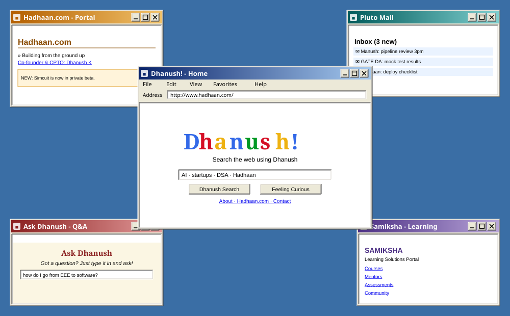

<a href="https://hadhaan.com">
  <!--  -->
</a>

# ⚽ THE PLAYER PROFILE

**DHANUSH KRISHNA** · `its.Pluto.44`

---

## 🏟️ MATCH STATISTICS

## ⚽ THE SQUAD

**ATTACK · AI / ML**

**MIDFIELD · LANGUAGES & SYSTEMS**

**DEFENCE · WEB DEVELOPMENT**

**GOALKEEPER · DATABASE & TOOLS**

## 📊 SEASON PERFORMANCE

---

## 🏆 FIND ME OFF THE PITCH

**90 MINUTES. NO SHORTCUTS.**

FULL TIME.

